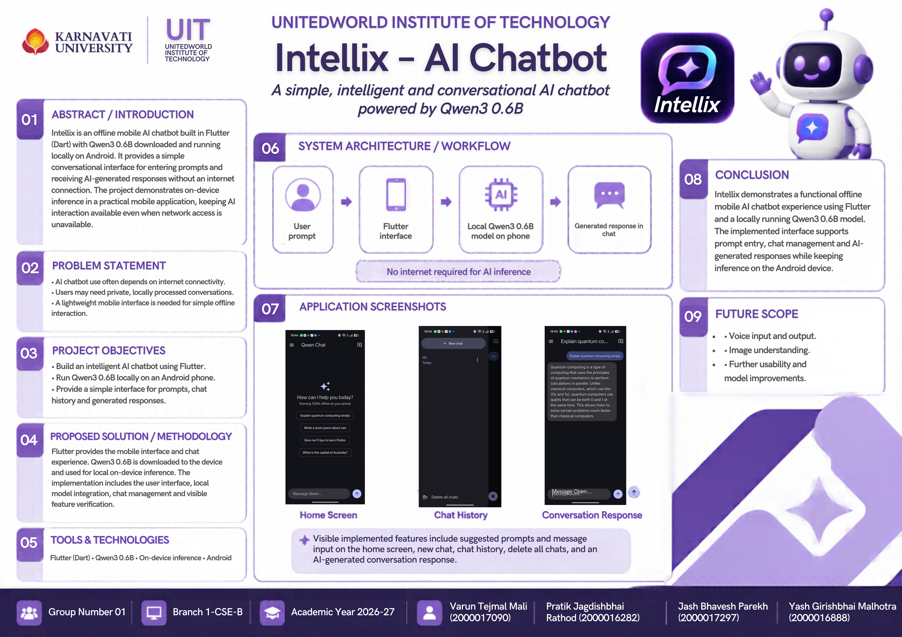

# Offline AI Chatbot

A ChatGPT-style AI chatbot for Android that runs **completely offline** on your phone. It uses the **Qwen3 0.6B** language model running on-device, so your conversations never leave your phone.

Built with **Flutter**.



## Demo

**[Watch the working video](Working%20Video.mp4)** to see the app in action.

## Features

- **100% offline chat.** After a one-time model download, no internet is needed.
- **Private.** The model runs on your phone and all chats stay on your device.
- **ChatGPT-style interface** with live, token-by-token streaming replies.
- **Chat history sidebar.** All chats are saved locally. Open, rename or delete any chat.
- **Stop button** to cancel a reply while it is being written.
- **New chat** with one tap.
- **Formatted answers.** Bold text, bullet lists and code blocks are displayed properly.
- **Copy any message** with a long-press.
- **Light and dark theme** that follows your phone settings.

## Download and install the app

1. Open the [`Apk`](Apk/) folder and download the APK file to your phone.
2. Open the file and tap **Install**. If Android asks, allow installing apps from this source.
3. Open the app. On the first launch, tap **Download** to get the AI model (about 590 MB). Use Wi-Fi.
4. When the download finishes, start chatting. From now on it works offline.

**Requirements**
- Android 11 or newer
- A 64-bit ARM phone (almost all phones from the last several years)
- About 1 GB of free storage and a few GB of RAM

## How it works

| Part | Technology |
| --- | --- |
| App framework | Flutter (Dart) |
| AI model | Qwen3 0.6B (`.litertlm` format) |
| On-device inference | `flutter_edge_ai` and `flutter_edge_ai_litertlm` (LiteRT-LM) |
| Chat history storage | `shared_preferences` |

The model file is downloaded once from Hugging Face (`litert-community/Qwen3-0.6B`) and stored on the phone. After that, all text generation happens locally.

## Build from source

The full Flutter project is in the [`Code`](Code/) folder.

```bash
cd Code
flutter pub get
flutter build apk --release --target-platform android-arm64
```

The APK is created at `build/app/outputs/flutter-apk/app-release.apk`.

Before building, make sure of the following:
- `minSdk` is set to **30** in `android/app/build.gradle.kts`
- The `INTERNET` permission is in `android/app/src/main/AndroidManifest.xml` (needed for the first model download)
- You test on a real ARM phone. The model does not run on the x86 emulator.

### Project structure

```
Code/lib/
├── main.dart           App entry point
├── config.dart         Model URL, context size, system prompt
├── llm_service.dart    Model download, loading, streaming replies
├── chat_screen.dart    Chat UI
├── history_drawer.dart Chat history sidebar
├── chat_store.dart     Saves chats on the phone
├── models.dart         Message and conversation data
├── setup_screen.dart   Download and loading screen
└── markdown_text.dart  Formats bold text, lists and code in replies
```

## Limitations

- Qwen3 0.6B is a small model. It is fast and light, but its answers can be less accurate than large cloud models like ChatGPT. Double-check important facts.
- It works best in English.
- The model has a small context window. When you reopen an old chat, the model sees only its most recent part, although you can still read the full chat on screen.
- Replies are slower on low-end phones.

## Credits

- [Qwen](https://huggingface.co/Qwen) by Alibaba Cloud for the language model
- [litert-community](https://huggingface.co/litert-community) for the on-device model conversion
- [`flutter_edge_ai`](https://pub.dev/packages/flutter_edge_ai) for running the model in Flutter

The model weights belong to their respective owners. See the model page on Hugging Face for license terms.

## Author

Made by [VarunMali009](https://github.com/VarunMali009)
